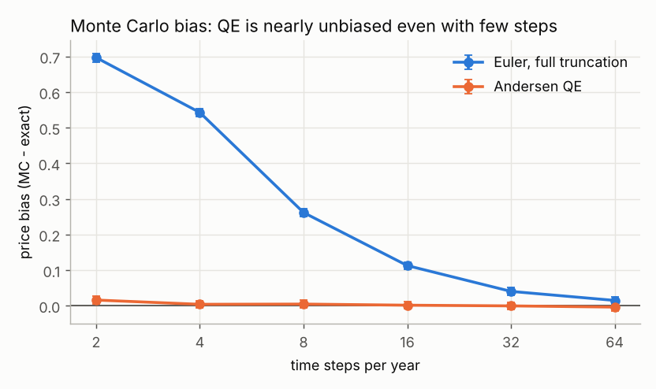
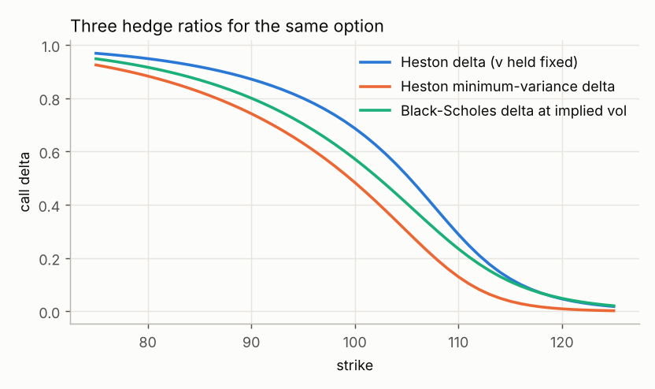
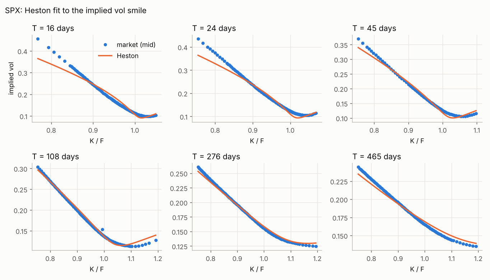
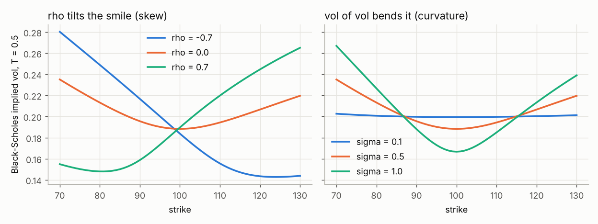

# Heston Pricing Engine

[](https://github.com/Subham1709/Heston_Pricing_Engine/actions/workflows/tests.yml)

**Live app: [subham-heston-engine.streamlit.app](https://subham-heston-engine.streamlit.app)**
(price options seven ways, move the parameters and watch the smile, see the SPX fit; [app/README.md](app/README.md))

A from-scratch Python engine for the Heston (1993) stochastic volatility model, built the
way bank pricing libraries are: **several independent pricing methods, each validated
against the others and against published benchmarks**, then calibrated to real index
option prices.

| Family | Methods | Used for |
|---|---|---|
| Fourier | Gil-Pelaez integral, Carr-Madan FFT, Fang-Oosterlee COS | fast, exact European prices; calibration |
| Monte Carlo | Euler full truncation, Andersen QE, antithetics, control variates | path-dependent payoffs; the deep hedging simulator |
| Finite differences | 1D Crank-Nicolson + Rannacher + PSOR; 2D Heston PDE with ADI (Douglas, Craig-Sneyd, Hundsdorfer-Verwer) | American options, Greeks |

Plus Black-Scholes prices, Greeks and a robust implied-vol solver, Heston Greeks three ways,
and vega-weighted calibration with forwards backed out of put-call parity.

## Results

**One option, seven methods.** Fang & Oosterlee (2008) test case (Feller condition
violated, the hard case), reference price 5.785155450:

| Method | Error | Time |
|---|---|---|
| Gil-Pelaez integral (adaptive quadrature) | 2e-8 | 1.7 ms |
| Carr-Madan FFT, N = 4096 | 2e-7 | 0.8 ms |
| **COS, N = 256** | **8e-8** | **0.15 ms** |
| Monte Carlo, Euler, 100 steps, 400k paths | 1.5e-2 | 1.4 s |
| Monte Carlo, Andersen QE, 100 steps, 400k paths | 2e-3 (std err 8e-3) | 3.2 s |
| PDE, ADI Hundsdorfer-Verwer, 200 x 100 grid, 100 steps | 6e-4 | 0.26 s |
| PDE, ADI Craig-Sneyd, same grid | 6e-4 | 0.30 s |



- **COS converges exponentially** in the number of terms and is ~10,000x faster than
  Monte Carlo at five more digits of accuracy ([convergence plot](results/fourier_convergence.png)).
- **Andersen's QE scheme removes the discretisation bias** that plagues Euler when the
  variance can hit zero: with 4 steps a year, Euler is off by 0.54, QE by 0.004.
- **Measured convergence orders match theory**: Crank-Nicolson second order, implicit
  Euler first; ADI Douglas first order in time with correlation, CS and HV second
  ([ADI convergence](results/adi_convergence.png)).
- **Rannacher smoothing** removes the spurious Gamma oscillations Crank-Nicolson produces
  at the strike ([figure](results/rannacher_gamma.png)).
- **American options**: Black-Scholes American put 6.0900 (literature 6.0904); Heston
  American puts match the Clarke-Parrott benchmark to ~4e-4.

**Three hedge ratios for one option** ([greeks.md](results/greeks.md)): for an ATM call with
rho = -0.7, Black-Scholes delta at implied vol is 0.572, Heston delta 0.687, and the
minimum-variance delta 0.484. Which one hedges best in practice is the question for the
follow-up deep hedging project.



**Calibration to real SPX options** ([calibration.md](results/calibration.md)): 1,880
out-of-the-money quotes across 13 expiries (16 to 465 days), snapshot of 12 Oct 2026
closing quotes (spot 7807). One set of five parameters fits the whole surface to
**0.90 vol points RMSE**, under 0.5 vol points beyond 3 months:

| v0 | kappa | theta | sigma | rho | Feller ratio |
|---|---|---|---|---|---|
| 0.0136 (11.6% vol) | 7.41 | 0.0421 (20.5% vol) | 1.89 | -0.65 | 0.17 |



The fit is good from 3 months out, but Heston **can't produce the steep skew of
short-dated options** (1.8 vol points error at 16 days, with the deep downside wing too
cheap). To try, the optimiser pushes kappa and vol-of-vol to extreme values. This is the
model's known weakness, and why desks add jumps (Bates) or use rough or local-stochastic
volatility models. The NIFTY download failed (NSE blocks GitHub's servers), so only SPX
is calibrated.

Full tables: [results/validation.md](results/validation.md).

## How each parameter shapes the smile



## Layout

```
src/heston/
  black_scholes.py   BS price, Greeks, implied vol (Newton + Brent)
  model.py           Heston parameters, characteristic function ("little trap" form), cumulants
  fourier.py         Gil-Pelaez, Carr-Madan FFT, COS
  monte_carlo.py     Euler full truncation, Andersen QE, MC pricer with control variate
  fd1d.py            theta-scheme / Crank-Nicolson, Rannacher, PSOR for American options
  fd_adi.py          2D Heston PDE on non-uniform grids, Douglas / CS / HV ADI
  calibration.py     chain cleaning, parity forwards, vega-weighted least squares
  greeks.py          COS bumps, ADI grid Greeks, MC pathwise delta, min-variance delta
scripts/
  01_download_chains.py   SPX (Yahoo) and NIFTY (NSE) option chains -> data/
  02_validate_methods.py  all methods vs each other, convergence studies -> results/
  03_calibrate.py         calibration to the snapshot in data/ -> results/
  04_greeks.py            Greeks and hedge ratios -> results/
tests/                    70 tests: benchmarks, limits, convergence orders, parity
docs/LEARNING_LOG.md      step-by-step notes: what, why, and interview questions
app/                      Streamlit web app
```

## Running it

```bash
pip install -r requirements.txt
pytest -q
python scripts/02_validate_methods.py
python scripts/03_calibrate.py      # uses the committed snapshot in data/
python scripts/04_greeks.py
```

Market data is downloaded by the `download-data` GitHub Actions workflow and committed to
`data/`; the `experiment` workflow reruns every script and commits `results/`.

## References

- Heston (1993), *A closed-form solution for options with stochastic volatility*.
- Albrecher, Mayer, Schoutens & Tistaert (2007), *The little Heston trap*.
- Carr & Madan (1999), *Option valuation using the fast Fourier transform*.
- Fang & Oosterlee (2008), *A novel pricing method for European options based on Fourier-cosine series expansions*.
- Andersen (2008), *Simple and efficient simulation of the Heston stochastic volatility model*.
- Lord, Koekkoek & van Dijk (2010), *A comparison of biased simulation schemes for stochastic volatility models*.
- In 't Hout & Foulon (2010), *ADI finite difference schemes for option pricing in the Heston model with correlation*.
- Rannacher (1984), *Finite element solution of diffusion problems with irregular data*.
- Bakshi, Cao & Chen (1997), *Empirical performance of alternative option pricing models*.
