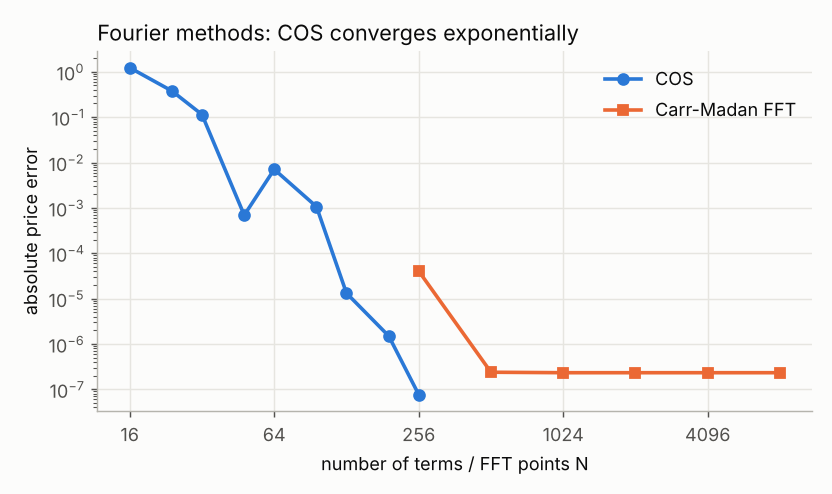
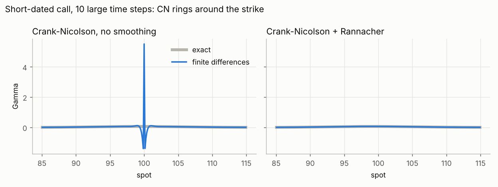
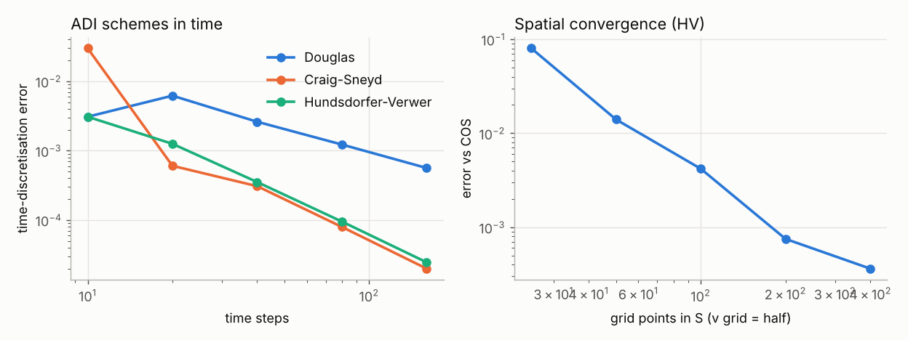

# Validation: one option, five methods

Fang & Oosterlee (2008) test case: S = K = 100, T = 1, r = 0, v0 = 0.0175, kappa = 1.5768, theta = 0.0398, sigma = 0.5751, rho = -0.5711 (Feller ratio 0.38, so the variance hits zero). Reference price 5.78515545.

| Method                                          |   Price |   Error vs reference |   Time (ms) |
|:------------------------------------------------|--------:|---------------------:|------------:|
| Gil-Pelaez integral (adaptive quadrature)       | 5.78516 |         -1.57107e-08 |    1.66986  |
| Carr-Madan FFT (N = 4096)                       | 5.78516 |         -2.32703e-07 |    0.815018 |
| COS (N = 256)                                   | 5.78516 |         -7.66083e-08 |    0.148428 |
| Monte Carlo, Euler, 100 steps, 400k paths       | 5.80038 |          0.0152293   | 1408.92     |
| Monte Carlo, Andersen QE, 100 steps, 400k paths | 5.78296 |         -0.00219176  | 3221.22     |
| PDE, ADI Hundsdorfer-Verwer, 200 x 100 x 100    | 5.78453 |         -0.000629241 |  264.083    |
| PDE, ADI Craig-Sneyd, 200 x 100 x 100           | 5.78451 |         -0.000643255 |  298.676    |

## Fourier convergence

|   N |   COS error |
|----:|------------:|
|  16 |    1.23e+00 |
|  24 |    3.77e-01 |
|  32 |    1.14e-01 |
|  48 |    6.91e-04 |
|  64 |    7.07e-03 |
|  96 |    1.06e-03 |
| 128 |    1.32e-05 |
| 192 |    1.50e-06 |
| 256 |    7.66e-08 |

## Monte Carlo discretisation bias (1M paths, antithetic + control variate)

| scheme   |   steps |    bias |   std error |
|:---------|--------:|--------:|------------:|
| euler    |       2 |  0.6970 |      0.0060 |
| euler    |       4 |  0.5428 |      0.0056 |
| euler    |       8 |  0.2618 |      0.0053 |
| euler    |      16 |  0.1128 |      0.0052 |
| euler    |      32 |  0.0403 |      0.0051 |
| euler    |      64 |  0.0149 |      0.0050 |
| qe       |       2 |  0.0160 |      0.0051 |
| qe       |       4 |  0.0040 |      0.0052 |
| qe       |       8 |  0.0047 |      0.0053 |
| qe       |      16 |  0.0016 |      0.0053 |
| qe       |      32 | -0.0004 |      0.0052 |
| qe       |      64 | -0.0038 |      0.0051 |

Control variate (stock price), K = 90 call: standard error 0.0125 -> 0.0076 (63% less variance, same paths).

## Crank-Nicolson and Rannacher smoothing

Black-Scholes ATM call (exact 10.450584), time steps = grid points / 2:

|   grid points |   Crank-Nicolson error |   implicit Euler error |
|--------------:|-----------------------:|-----------------------:|
|            50 |               5.38e-02 |               9.54e-02 |
|           100 |               1.33e-02 |               3.41e-02 |
|           200 |               3.33e-03 |               1.37e-02 |
|           400 |               8.32e-04 |               6.06e-03 |
|           800 |               2.08e-04 |               2.83e-03 |

Halving the grid divides the Crank-Nicolson error by ~4 (second order) and the implicit Euler error by ~2 (first order in time).

American put (S = K = 100, r = 5%, vol = 20%, T = 1) by PSOR: 6.0900 vs European 5.5735; literature value 6.0904.

## Heston PDE with ADI

In 't Hout & Foulon case: K = 100, T = 1, r = 2.5%, kappa = 1.5, theta = 0.04, sigma = 0.3, rho = -0.9, v0 = 0.04. COS reference 8.894869.

Time-discretisation error (vs the same grid with 1280 steps):

|   time steps |   douglas |       cs |       hv |
|-------------:|----------:|---------:|---------:|
|           10 |  3.08e-03 | 2.98e-02 | 3.07e-03 |
|           20 |  6.19e-03 | 6.04e-04 | 1.25e-03 |
|           40 |  2.61e-03 | 3.07e-04 | 3.52e-04 |
|           80 |  1.22e-03 | 7.94e-05 | 9.49e-05 |
|          160 |  5.62e-04 | 1.99e-05 | 2.46e-05 |

Spatial error (100 time steps):

| grid (S x v)   |   HV error vs COS |
|:---------------|------------------:|
| 25 x 12        |          8.01e-02 |
| 50 x 25        |          1.40e-02 |
| 100 x 50       |          4.18e-03 |
| 200 x 100      |          7.50e-04 |
| 400 x 200      |          3.62e-04 |
